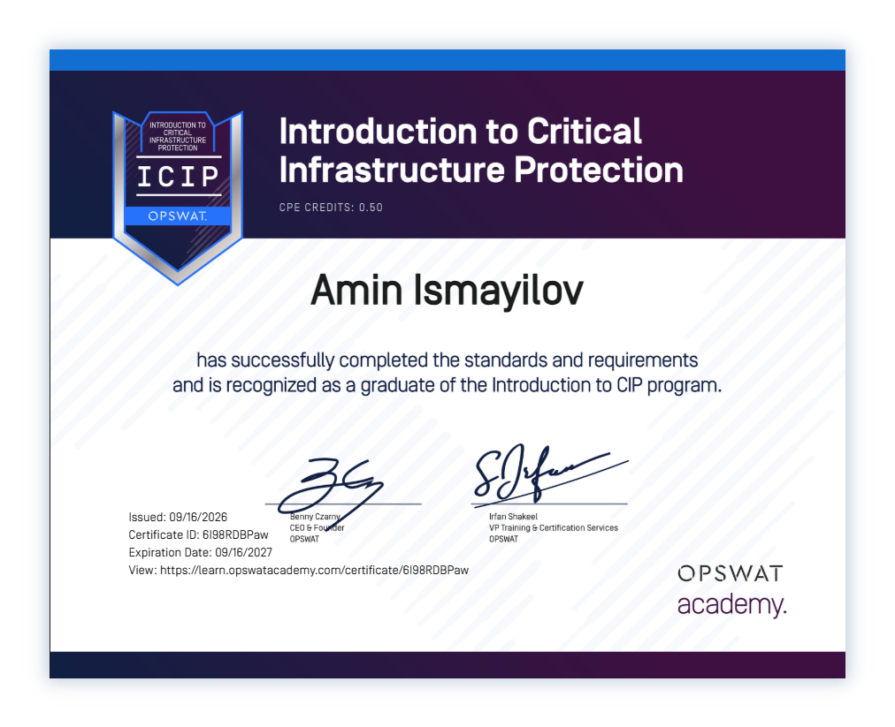

<h1 align="center">Certifications</h1>

<i>What I have completed so far, with proof you can check</i>

[← Back to portfolio](../README.md)

---

## 📋 Overview

| Certification | Issuer | Completed | Status | Proof |
|---|---|---|---|---|
| Introduction to Critical Infrastructure Protection (CIP) | OPSWAT Academy | 16.09.2026 | ✅ Completed | [Verify](https://learn.opswatacademy.com/certificate/6I98RDBPaw) · [PDF](opswat-cip-certificate.pdf) |
| Google Cybersecurity Certificate | Coursera | 24.11.2026 | ✅ Completed | [Verify](https://coursera.org/verify/professional-cert/4B1F0IYW6MI4) · [PDF](google-cybersecurity-certificate.pdf) |
| Pre Security (SEC0) | TryHackMe | - | 📅 Planned | - |
| Cyber Security 101 (SEC1) | TryHackMe | - | 📅 Planned | - |
| Security Analyst Level 1 (SAL1) | TryHackMe | - | 📅 Planned | - |
| CompTIA Security+ | CompTIA | - | 📅 Planned | - |

---

## ✅ Introduction to Critical Infrastructure Protection (CIP)

| | |
|---|---|
| **Issuer** | OPSWAT Academy |
| **Issued** | 16.09.2026 |
| **Valid until** | 16.09.2027 |
| **Certificate ID** | 6I98RDBPaw |
| **CPE credits** | 0.5 |
| **Course length** | About 20 minutes, 1 module with 4 lessons |
| **Proof** | [Verify online](https://learn.opswatacademy.com/certificate/6I98RDBPaw) · [Certificate (PDF)](opswat-cip-certificate.pdf) |

**What the course covers:** an introduction, the fundamentals of critical infrastructure protection, the main critical infrastructure sectors, and why cybersecurity matters for them. It also looks at how countries and regions define and protect their critical infrastructure.

**What I learned:** Critical infrastructure means the systems a country depends on every day, such as energy and water. I learned why these systems need special protection and how they depend on each other, so one successful attack can spread to other services. It was a short course, but it was my first step into this side of security. It showed me that cybersecurity protects more than data. It also protects services that people rely on.

The PDF is made from a screenshot of my certificate. The online link above is the official proof.

---

## ✅ Google Cybersecurity Certificate

| | |
|---|---|
| **Issuer** | Google, on Coursera |
| **Completed** | 24.11.2026 |
| **Courses** | 9 of 9 |
| **Proof** | [Verify on Coursera](https://coursera.org/verify/professional-cert/4B1F0IYW6MI4) · [Certificate (PDF)](google-cybersecurity-certificate.pdf) |
| **Full notes** | [Google Cybersecurity Certificate overview](../coursera-google-cybersecurity/README.md) |

**What I covered:** security basics and risk management, networks, Linux and SQL, assets, threats and vulnerabilities, detection and response, Python automation and job preparation.

| # | Course | Notes |
|---|---|---|
| 1 | Foundations of Cybersecurity | [Read](../coursera-google-cybersecurity/courses/01-foundations-of-cybersecurity.md) |
| 2 | Play It Safe: Manage Security Risks | [Read](../coursera-google-cybersecurity/courses/02-manage-security-risks.md) |
| 3 | Connect and Protect: Networks and Network Security | [Read](../coursera-google-cybersecurity/courses/03-networks-and-network-security.md) |
| 4 | Tools of the Trade: Linux and SQL | [Read](../coursera-google-cybersecurity/courses/04-linux-and-sql.md) |
| 5 | Assets, Threats, and Vulnerabilities | [Read](../coursera-google-cybersecurity/courses/05-assets-threats-and-vulnerabilities.md) |
| 6 | Sound the Alarm: Detection and Response | [Read](../coursera-google-cybersecurity/courses/06-detection-and-response.md) |
| 7 | Automate Cybersecurity Tasks with Python | [Read](../coursera-google-cybersecurity/courses/07-python-automation.md) |
| 8 | Put It to Work: Prepare for Cybersecurity Jobs | [Read](../coursera-google-cybersecurity/courses/08-prepare-for-cybersecurity-jobs.md) |
| 9 | Accelerate Your Job Search with AI | [Read](../coursera-google-cybersecurity/courses/09-accelerate-your-job-search-with-ai.md) |

---

## 📅 Planned

| Certification | Issuer | Status |
|---|---|---|
| Pre Security (SEC0) | TryHackMe | Planned |
| Cyber Security 101 (SEC1) | TryHackMe | Planned |
| Security Analyst Level 1 (SAL1) | TryHackMe | Planned |
| CompTIA Security+ | CompTIA | Planned |
